# TugasWeb-P10-BlogCRUD

   Tugas Rutin 10 — Pemrograman Web (3KOM40115), UNIMED
   Nama: Muhammad Hafizh Maulana· NIM: 4253550005 · Kelas: PSIK 25D
## Langkah Instalasi

1. Buat project baru (bisa lanjutan dari project TR9 atau project baru):
   ```bash
   composer create-project --prefer-dist laravel/laravel:^11.x TugasWeb-P10-BlogCRUD
   cd TugasWeb-P10-BlogCRUD
   ```
2. Konfigurasi `.env` ke MySQL, buat database baru misal `tugasweb_p10` di phpMyAdmin.
3. Copy semua file dari folder ini (`routes/`, `app/`, `database/migrations/`, `resources/views/`) ke project, timpa file yang sudah ada.
4. Migrasi:
   ```bash
   php artisan migrate
   ```
5. Jalankan:
   ```bash
   php artisan serve
   ```
6. Buka `http://127.0.0.1:8000/posts`.

## Requirement yang Dipenuhi

1. ✅ `Route::resource('posts', PostController::class)` + named routes otomatis (posts.index, posts.create, dst).
2. ✅ `PostController` dengan 7 method resource lengkap (index, create, store, show, edit, update, destroy).
3. ✅ Layout master `layouts/app.blade.php` dengan `@extends` / `@yield`.
4. ✅ Minimal 2 komponen: `<x-alert>` dan `<x-card>` (di `resources/views/components/`).
5. ✅ Validasi + pesan error per field + `old()` input di form create & edit.
6. ✅ Flash message sukses/gagal ditampilkan lewat komponen alert di layout.
7. ✅ `@csrf` di semua form + `@method('PUT')`/`@method('DELETE')` untuk update & delete.
8. ✅ Route Model Binding (via slug, lihat `getRouteKeyName()` di `Post` model) + pagination (`->paginate(6)`).

## Bonus yang Diimplementasikan

- **Pencarian**: form search di halaman index (`?q=...`), pakai scope `search()` di model.
- **Soft delete**: model `Post` pakai trait `SoftDeletes`, kolom `deleted_at` ada di migration.
- Upload gambar tidak diimplementasikan di versi ini — bisa ditambahkan mengikuti pola `FileUpload`/`store('posts', 'public')` seperti di praktikum Filament/CRUD basic kalau ingin nilai bonus tambahan.

## Testing Manual

1. Tambah beberapa post lewat `/posts/create`.
2. Coba submit form kosong → pastikan pesan error per field muncul dan input lama tidak hilang (`old()`).
3. Edit salah satu post → pastikan flash message "Post berhasil diperbarui" muncul.
4. Hapus salah satu post → cek di database kolom `deleted_at` terisi (bukan benar-benar terhapus, karena soft delete).
5. Coba fitur pencarian di kolom search.

## Screenshot

| Fitur | Gambar |
|-------|--------|
| Daftar post + flash sukses tambah | 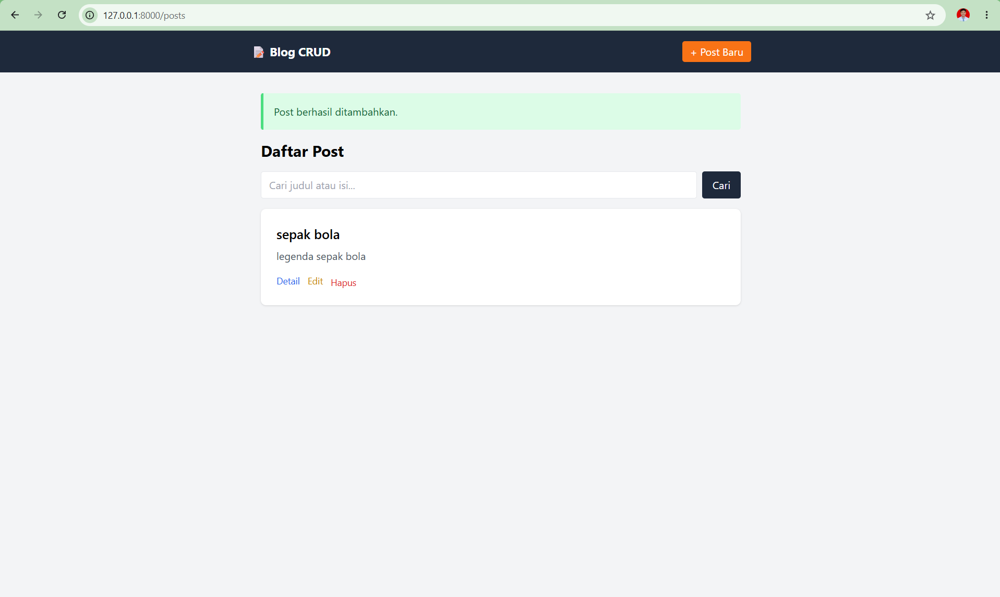 |
| Daftar dengan 7 post | 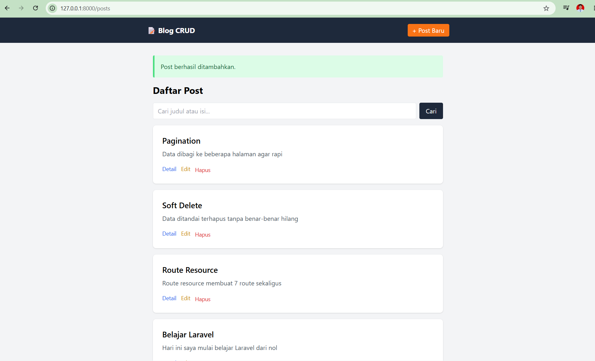 |
| Pagination (halaman 2) | 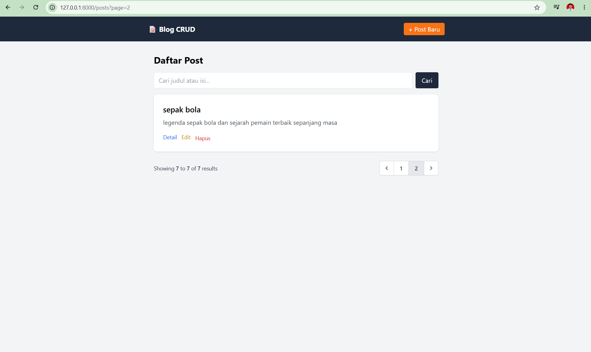 |
| Form tambah post | 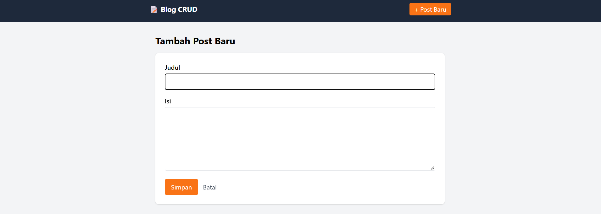 |
| Validasi error per field | 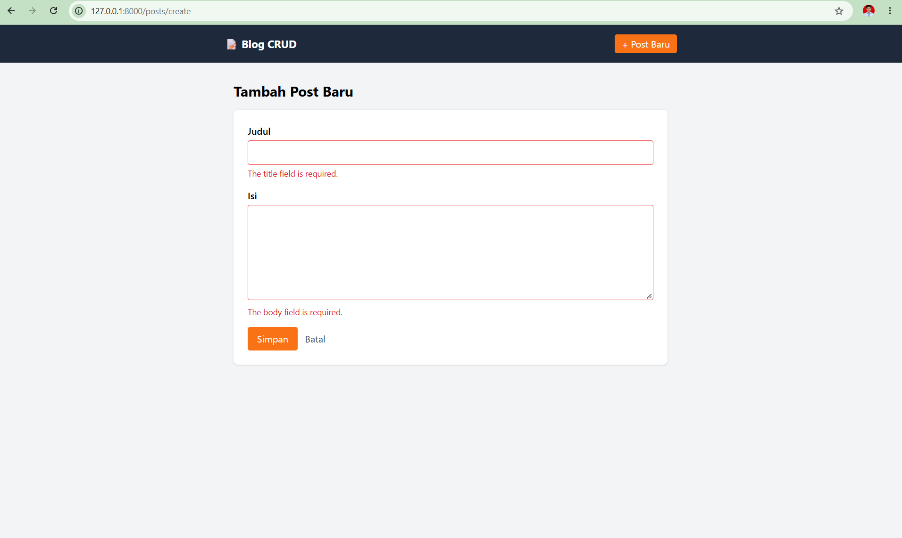 |
| Detail post (Route Model Binding via slug) | 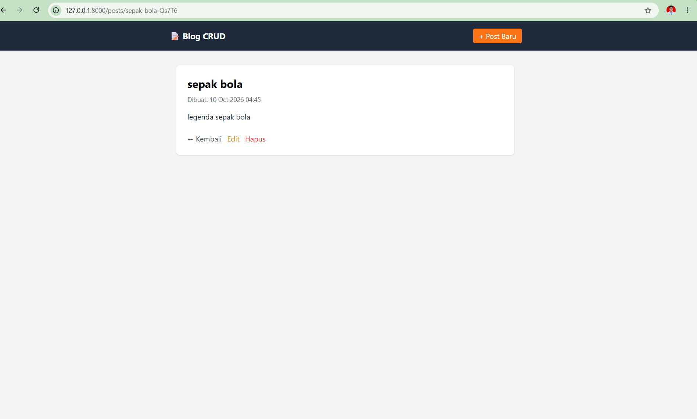 |
| Form edit | 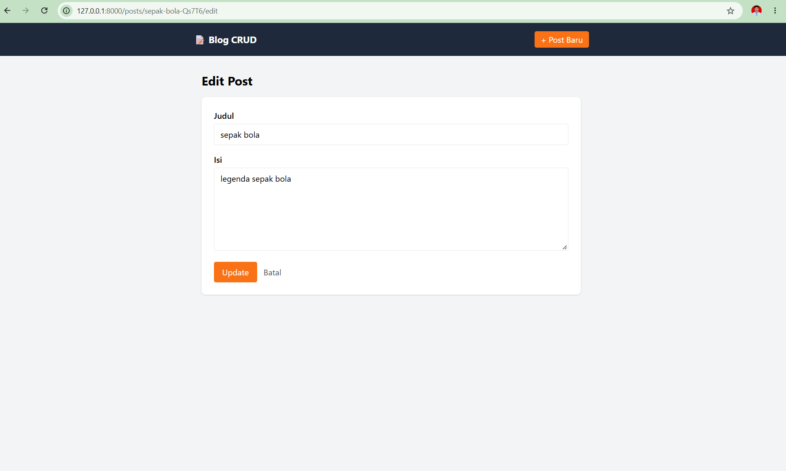 |
| Flash sukses update | 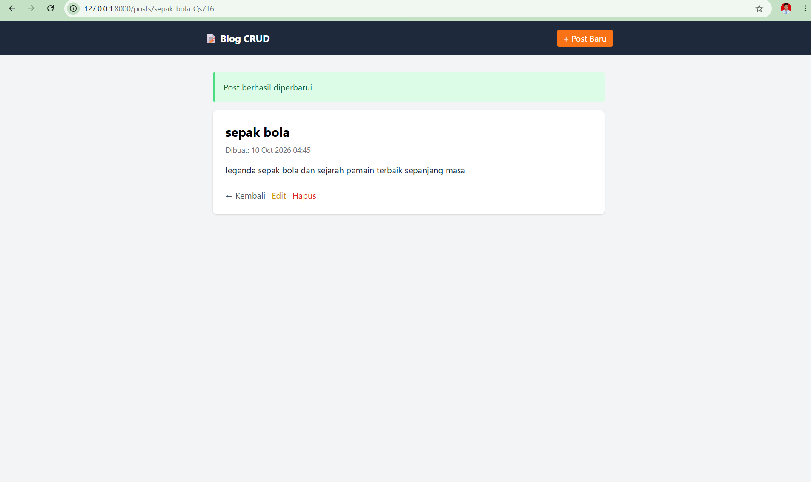 |
| Pencarian (`?q=bola`) | 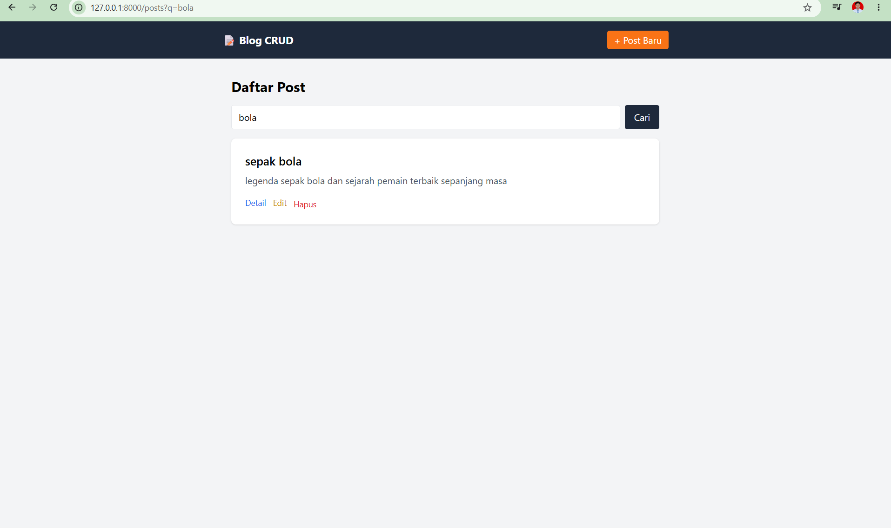 |
| Konfirmasi hapus | 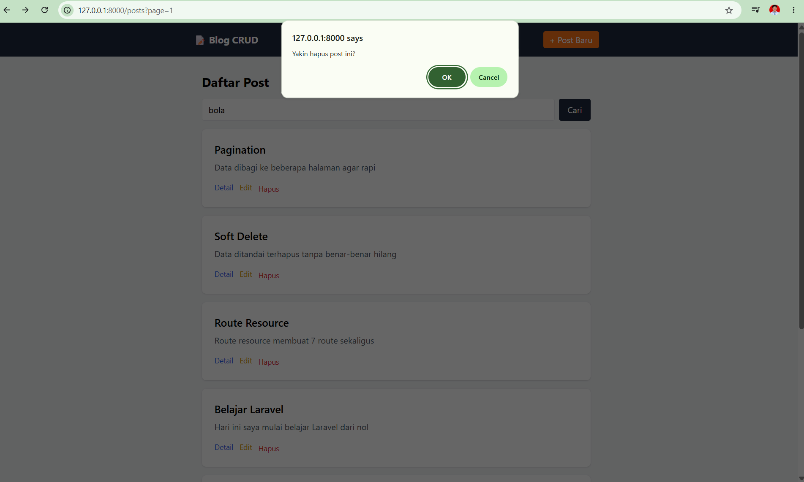 |
| Flash sukses hapus (soft delete) | 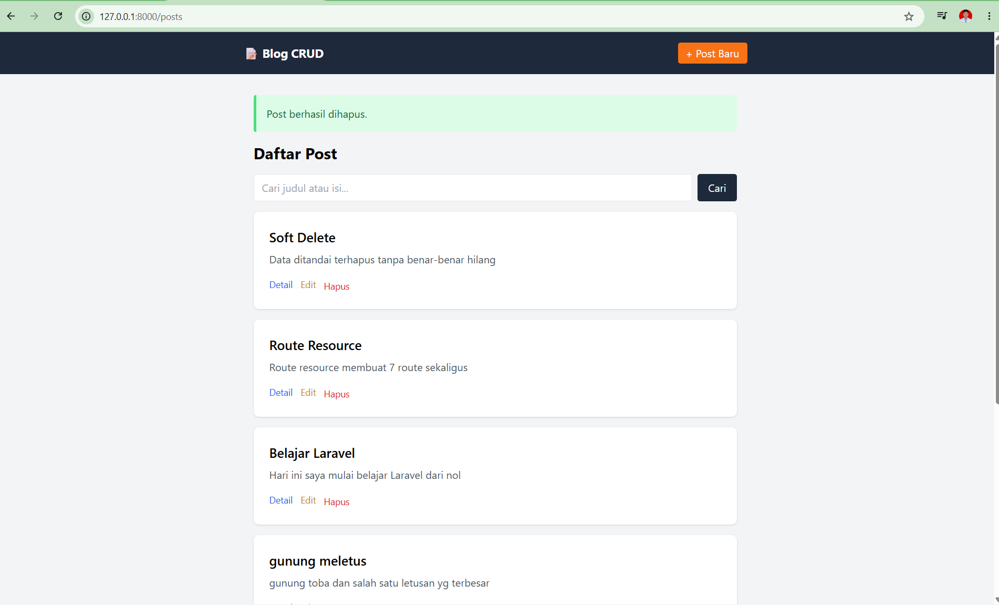 |
